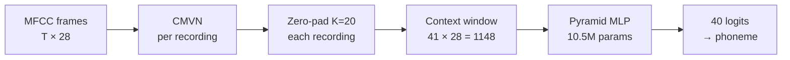
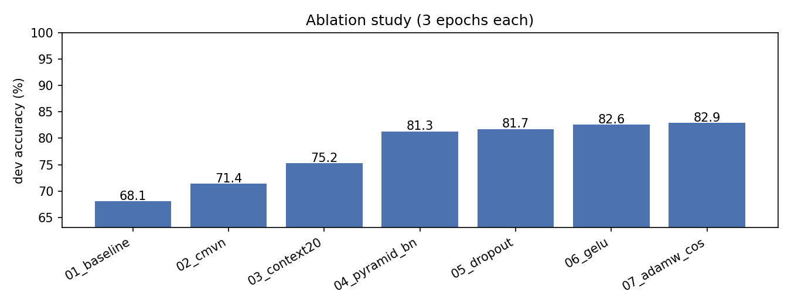
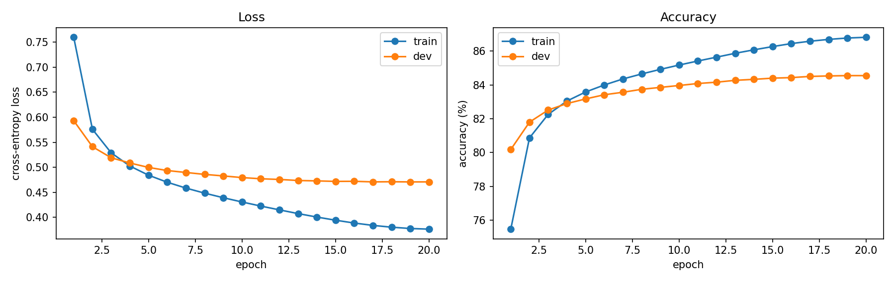
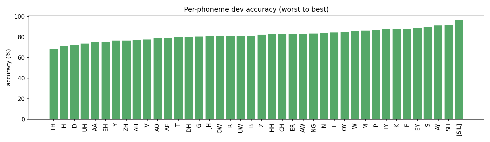
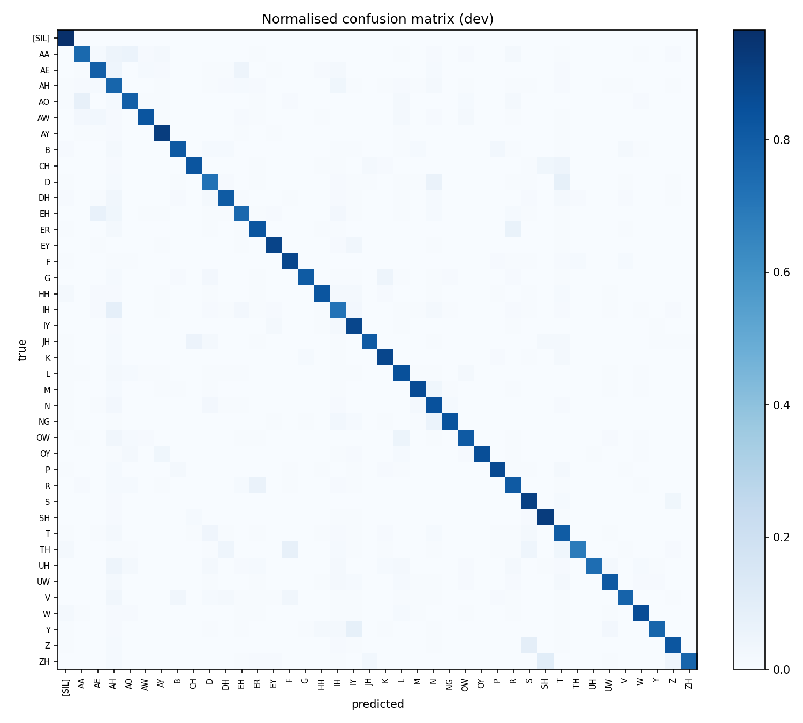
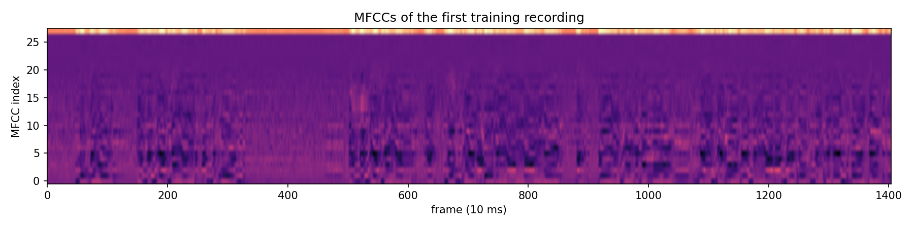
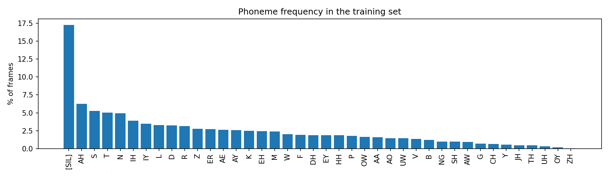

<div align="center">

# Frame-Level Phoneme Recognition with a Multilayer Perceptron

**Classifying every 10 ms of speech into one of 40 phonemes with a context-window MLP in PyTorch**


</div>

---

## Overview

This project is a solution to the Kaggle competition **11-785 HW1P2 (Fall 2024)**, from Carnegie Mellon's
*Introduction to Deep Learning* course. It was completed as Project 1 of the Deep Learning course at E-JUST.

Speech from the LibriSpeech corpus is split into 10 ms frames, each described by 28 MFCC coefficients.
The task is to predict, **for every frame**, which of **40 classes** (39 English phonemes and silence) is
being spoken. The model must be a multilayer perceptron with fewer than 20 million parameters.

### Key results

| Metric | Value |
|---|---|
| Dev accuracy (best epoch) | **84.55%** |
| Train accuracy | 86.81% (gap of 2.3 points) |
| Gain over the baseline MLP | **+16.5 points** (68.06% → 84.55%) |
| Parameters | 10,519,592 (limit: 20M) |
| Training time | 67.6 min for 20 epochs on an RTX 4050 Laptop GPU (6 GB) |

---

## Method



| Component | Choice | Purpose |
|---|---|---|
| Normalisation | CMVN: mean 0, std 1 per recording and coefficient | removes speaker and microphone variation |
| Context | K = 20 frames on each side (41 frames ≈ 0.41 s) | a single 10 ms frame is too short to identify a phoneme |
| Architecture | 2048 → 2048 → 1024 → 1024 → 512 → 512 → 40 | wide early layers, narrowing towards the classes |
| Hidden block | Linear → BatchNorm → GELU → Dropout (0.2) | stable training of a deep network, with regularisation |
| Optimisation | AdamW (lr 1e-3, weight decay 0.01), cosine schedule | strong final convergence and less overfitting |
| Efficiency | data kept on the GPU in float16, mixed-precision training | 3.4 min per epoch over 36M training frames |

---

## Results

### Ablation study

Starting from a small baseline, **one change is added at a time** (3 epochs each, same seed), so each
step's effect on dev accuracy is measured on its own.

| Step | Change | Params | Dev accuracy | Gain |
|:---:|---|---:|---:|---:|
| 1 | Baseline: K=5, 2×512, ReLU, Adam | 0.44M | 68.06% | — |
| 2 | + CMVN normalisation | 0.44M | 71.36% | +3.30 |
| 3 | + context window K=20 | 0.87M | 75.24% | +3.88 |
| 4 | + pyramid MLP + BatchNorm | 10.5M | 81.28% | **+6.04** |
| 5 | + Dropout 0.2 | 10.5M | 81.74% | +0.46 |
| 6 | + GELU activation | 10.5M | 82.55% | +0.81 |
| 7 | + AdamW + cosine schedule | 10.5M | 82.90% | +0.35 |
| **Final** | step 7 trained for 20 epochs | 10.5M | **84.55%** | +1.65 |

<p align="center">
  
</p>

The largest gains come from **model capacity** (step 4), **context** (step 3) and **normalisation**
(step 2). Step 4 started to overfit: dev loss rose from 0.578 to 0.596 in its third epoch, and dropout in
step 5 corrected this.

### Final training

<p align="center">
  
</p>

Dev loss decreases throughout training and never rises, so the final model shows no sign of overfitting.
An excerpt of the training log (the ETA column is omitted):

```text
[final] epoch  1/20  lr 1.00e-03  train loss 0.7597 acc 75.46%  |  dev loss 0.5932 acc 80.18%  |  3.4 min/epoch
[final] epoch  5/20  lr 9.05e-04  train loss 0.4843 acc 83.58%  |  dev loss 0.4998 acc 83.17%  |  3.4 min/epoch
[final] epoch 10/20  lr 5.78e-04  train loss 0.4308 acc 85.17%  |  dev loss 0.4795 acc 83.96%  |  3.4 min/epoch
[final] epoch 15/20  lr 2.06e-04  train loss 0.3944 acc 86.26%  |  dev loss 0.4719 acc 84.40%  |  3.4 min/epoch
[final] epoch 19/20  lr 2.45e-05  train loss 0.3779 acc 86.77%  |  dev loss 0.4709 acc 84.55%  |  3.4 min/epoch
[final] epoch 20/20  lr 6.16e-06  train loss 0.3765 acc 86.81%  |  dev loss 0.4709 acc 84.55%  |  3.4 min/epoch
best dev accuracy: 84.55%  (epoch 19)
```

### Error analysis

<p align="center">
  
</p>

<table>
<tr>
<td width="55%"></td>
<td>

**Most frequent confusions (dev)**

| True | Predicted | Rate |
|:---:|:---:|---:|
| ZH | SH | 10.5% |
| Z | S | 9.2% |
| IH | AH | 8.7% |
| Y | IY | 8.3% |
| D | T | 7.9% |
| TH | F | 7.6% |

Errors are concentrated between phonetically similar sounds, mostly voiced/unvoiced pairs and
neighbouring vowels.

</td>
</tr>
</table>

### Data exploration

<p align="center">
  
  
</p>

The classes are imbalanced: silence makes up 17.3% of training frames, so always predicting silence
would already score about 17%.

---

## Repository structure

```text
phoneme-recognition-mlp/
├── phoneme_recognition_mlp.ipynb   # full pipeline with all outputs
├── report/
│   ├── report.pdf                  # project report
│   ├── report.tex                  # LaTeX source
│   └── figures/
└── results/
    ├── figures/                    # all plots shown above
    ├── ablation.csv                # ablation results
    ├── per_class_acc.csv           # dev accuracy per phoneme
    ├── top_confusions.csv          # most frequent confusions
    └── summary.json                # final configuration and metrics
```

## Getting started

**Requirements:** Python 3.11, PyTorch 2.6 with CUDA, NumPy, pandas, matplotlib, scikit-learn, tqdm.
Hardware used: a CUDA GPU with 6 GB of memory and 16 GB of system RAM.

```bash
pip install torch --index-url https://download.pytorch.org/whl/cu124
pip install numpy pandas matplotlib scikit-learn tqdm jupyter
```

1. Download the competition data from Kaggle and extract it to `dataset/11785-f24-hw1p2/`.
2. Open `phoneme_recognition_mlp.ipynb` and select **Run All**. Set `DEBUG = True` first for a
   short end-to-end check on 500 recordings.
3. The notebook writes the merged data cache to `cache/`, one folder per training run to `runs/`, the
   figures and tables to `results/`, and the predictions to `submission.csv`.

Finished runs are detected and reloaded rather than retrained, so the notebook can be restarted safely.
Re-running it with saved runs takes about 5 minutes.

## Report

The full write-up, covering the method, the ablation study, the error analysis and the design choices, is
in [`report/report.pdf`](report/report.pdf).

## Author

**Yassin Mahmoud Alam Elden Abdelaziz**
